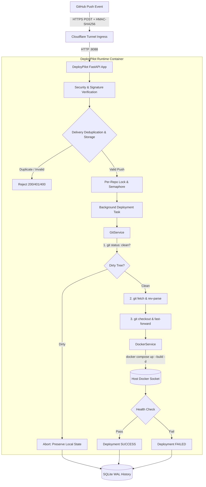

# DeployPilot

DeployPilot is a secure, production-quality Python service engineered for automating Git-based Docker Compose deployments on Synology NAS and Linux home servers via authenticated GitHub push webhooks.

---

## Architectural Overview

DeployPilot operates inside an isolated Python 3.12 container that interacts directly with the host's Docker socket and local repository directory tree. When GitHub notifies DeployPilot of a push event, it verifies the payload cryptographically, ensures the working tree is untouched, pulls the new commit non-destructively, invokes `docker compose up --build -d`, and polls container health before declaring success.



---

## Core Security & Reliability Guarantees

1. **Constant-Time HMAC-SHA256 Verification**: Payloads are authenticated against `X-Hub-Signature-256` using `hmac.compare_digest` to prevent timing attacks.
2. **Replay Attack & Duplicate Delivery Mitigation**: Every `X-GitHub-Delivery` UUID is logged in an indexed SQLite database in WAL mode; duplicates return an immediate 200 OK without triggering redundant builds.
3. **Dirty Tree Detection & Zero State Destructiveness**: DeployPilot runs `git status --porcelain`. If any uncommitted modifications, staged files, or untracked changes exist in the target repository, deployment aborts immediately to avoid overwriting host state.
4. **Strict Path Containment**: Repository paths must reside strictly within `ALLOWED_DEPLOYMENT_ROOT` (e.g., `/volume1/docker`). Relative path traversal (`../`) and unauthorized root escape attempts are rejected during configuration load.
5. **Safe Subprocess Execution**: Subprocesses are spawned in separate process groups via `preexec_fn=os.setsid` and bounded by strict timeouts. If a command hangs, `SIGTERM` and `SIGKILL` are sent to the entire process group.
6. **Secret Redaction**: Git tokens, passwords, and environment credentials in compose logs are filtered and replaced with `[REDACTED]` prior to persistence and output.
7. **Concurrency & Event Coalescing**: Per-repository `asyncio.Lock` prevents parallel builds of the same repository. If commits arrive while a build is executing, only the latest commit is retained in queue, superseding intermediate revisions.
8. **Crash Resilience**: On server startup, any deployment previously marked as `in_progress` is automatically reconciled and recorded as `interrupted`.

---

## Project Directory Structure

```
deploy-pilot/
├── app/
│   ├── api/
│   │   ├── deployments.py        # GET /api/v1/deployments (protected querying)
│   │   ├── health.py             # GET /api/v1/health & /ready probes
│   │   └── webhooks.py           # POST /api/v1/webhooks/github ingress
│   ├── core/
│   │   ├── config.py             # Pydantic v2 application settings & repository loader
│   │   ├── logging.py            # Structured logging with sensitive data masking
│   │   └── security.py           # Constant-time HMAC-SHA256 signature verification
│   ├── models/
│   │   ├── deployment.py         # Deployment records & lifecycle states
│   │   ├── repository.py         # Repository configuration & healthcheck models
│   │   └── webhook.py            # GitHub push event payload schema
│   ├── services/
│   │   ├── deployment_lock.py    # Concurrency locks, semaphore & event coalescer
│   │   ├── deployment_service.py # Orchestrator: Git -> Docker -> HealthCheck
│   │   ├── docker_service.py     # Docker compose execution & health polling
│   │   └── git_service.py        # Subprocess Git operations & clean tree verification
│   ├── storage/
│   │   └── deployment_history.py # SQLite WAL delivery deduplication & run history
│   └── main.py                   # FastAPI application factory & lifespan management
├── config/
│   └── repositories.example.yaml # Annotated repository configuration template
├── tests/
│   ├── integration/              # End-to-end FastAPI endpoint integration tests
│   ├── security/                 # Webhook attack & signature test suite
│   └── unit/                     # Config, Git, Docker, and Orchestrator tests
├── .github/workflows/ci.yml      # CI workflow: Ruff, Mypy, Pytest & Docker build
├── Dockerfile                    # Multi-stage production container definition
├── docker-compose.yml            # Deployment Compose file for DeployPilot
├── pyproject.toml                # Project metadata, dependencies & tool configs
└── README.md                     # Architecture, setup, and operational guide
```

---

## Synology NAS Deployment Guide

### Prerequisites
- Synology DSM 7.x (e.g., DS425+, DS920+, DS720+) with Docker / Container Manager installed.
- Cloudflare Tunnel (recommended) or reverse proxy exposing an external HTTPS endpoint to GitHub.
- Target repositories cloned under `/volume1/docker/`.

### Step 1: Prepare Host Directories
Create the DeployPilot home directory on the NAS:
```bash
mkdir -p /volume1/docker/deploy-pilot/config
mkdir -p /volume1/docker/deploy-pilot/data
```

### Step 2: Configure Environment Variables
Copy the template and configure your secrets:
```bash
cp .env.example /volume1/docker/deploy-pilot/.env
```

Edit `/volume1/docker/deploy-pilot/.env`:
```ini
WEBHOOK_SECRET=your_super_secret_github_webhook_token_32chars
API_AUTH_TOKEN=your_internal_management_api_key_32chars
DEPLOYMENT_ROOT=/volume1/docker
CONFIG_PATH=/app/config/repositories.yaml
DATABASE_PATH=/app/data/deployments.db
LOG_LEVEL=INFO
LOG_FORMAT=json
MAX_CONCURRENT_BUILDS=2
```

### Step 3: Configure Target Repositories
Copy the example YAML and configure the repositories you wish DeployPilot to manage:
```bash
cp config/repositories.example.yaml /volume1/docker/deploy-pilot/config/repositories.yaml
```

Example `/volume1/docker/deploy-pilot/config/repositories.yaml`:
```yaml
repositories:
  - id: my-app
    name: "My Awesome Web Service"
    github_repository: "myuser/my-app"
    branch: "main"
    deployment_path: "/volume1/docker/my-app"
    compose_file: "docker-compose.yml"
    enabled: true
    git_timeout_seconds: 60
    docker_timeout_seconds: 600
    health_check:
      endpoint: "/health"
      port: 8080
      expected_status: 200
      timeout_seconds: 60
      interval_seconds: 5
```

> [!IMPORTANT]
> Ensure the target repository is already cloned to `/volume1/docker/my-app` and has a clean working tree before setting `enabled: true`.

### Step 4: Launch DeployPilot
Start DeployPilot using Docker Compose:
```bash
cd /volume1/docker/deploy-pilot
docker compose up --build -d
```

Check the startup logs:
```bash
docker compose logs -f deploy-pilot
```

Verify service readiness:
```bash
curl -i http://localhost:8088/api/v1/health
curl -i http://localhost:8088/api/v1/ready
```

---

## GitHub Webhook Configuration

1. In GitHub, navigate to your target repository: **Settings** → **Webhooks** → **Add webhook**.
2. **Payload URL**: `https://deploy.yourdomain.com/api/v1/webhooks/github` (via Cloudflare Tunnel).
3. **Content type**: `application/json`.
4. **Secret**: Enter the exact `WEBHOOK_SECRET` defined in your `.env`.
5. **SSL verification**: Select **Enable SSL verification**.
6. **Which events would you like to trigger this webhook?**: Choose **Just the push event**.
7. Click **Add webhook**. GitHub will send a `ping` event. DeployPilot will respond with `200 OK` (`{"status": "ping_received"}`).

---

## REST API Reference

| Method | Endpoint | Auth | Description |
|---|---|---|---|
| `GET` | `/api/v1/health` | None | Basic liveness probe (checks process running). |
| `GET` | `/api/v1/ready` | None | Readiness probe (checks SQLite & Docker availability). |
| `POST` | `/api/v1/webhooks/github` | HMAC | GitHub push webhook ingress (202 Accepted on valid push). |
| `GET` | `/api/v1/deployments` | Bearer | Query recent deployment history (`?limit=20&repository_id=...`). |
| `GET` | `/api/v1/deployments/{id}` | Bearer | Inspect single deployment status, duration, and logs. |

---

## Operational Runbooks

### Handling Dirty Working Tree Failures
If DeployPilot logs:
```json
{"status": "failed", "error_message": "Working tree contains uncommitted changes. Aborting deployment."}
```
DeployPilot intentionally refused to overwrite files modified directly on the NAS. To resolve:
1. SSH into the NAS.
2. Navigate to the repository: `cd /volume1/docker/<repo_name>`.
3. Check uncommitted changes: `git status`.
4. Either commit the changes, stash them (`git stash`), or discard them (`git reset --hard HEAD && git clean -fd`).
5. Trigger a new commit or redeliver the webhook from GitHub's webhook history.

### Querying SQLite Deployment History
DeployPilot maintains deployment logs in `/volume1/docker/deploy-pilot/data/deployments.db`:
```bash
sqlite3 /volume1/docker/deploy-pilot/data/deployments.db \
  "SELECT id, repository_id, branch, status, duration_seconds, started_at FROM deployments ORDER BY started_at DESC LIMIT 5;"
```

---

## Development & Automated Testing

DeployPilot requires Python 3.12+ and uses `uv` for package management.

### Setup Local Environment
```bash
# Install dependencies
uv sync --all-extras --dev

# Run Ruff linter and formatter checks
uv run ruff check .
uv run ruff format --check .

# Run strict Mypy type validation
uv run mypy app

# Run full test suite with coverage
uv run pytest -v --cov=app --cov-report=term-missing
```
